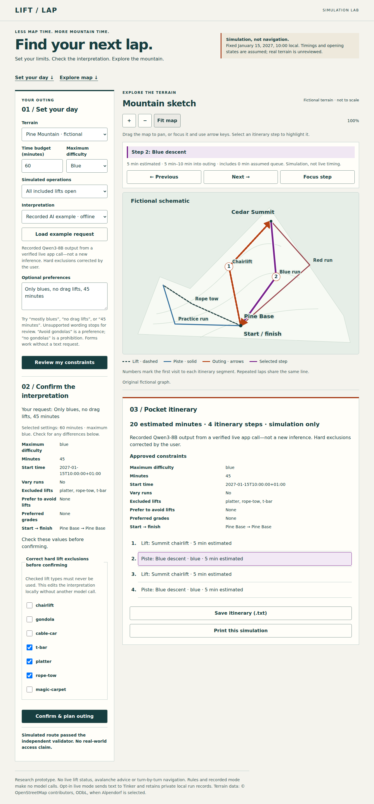

# Lift-Lap Planner

**Turn a short ski-outing request into constraints you can inspect, correct, and use to plan a simulated itinerary.**

Lift-Lap explores a simple division of responsibility: a language model interprets the request; a deterministic graph planner finds an outing; you confirm the constraints before a route is created. It is useful for developers exploring structured AI output and constrained planning, and for anyone who wants to try an interactive ski-planning prototype.

> **Simulation, not ski navigation.** Terrain, timings and lift operations are fictional or explicitly unreviewed. There is no live resort status, avalanche advice or field-verified routing.

[Watch the demo](demo/walkthrough.webm) · [User guide](docs/user-guide.md) · [Developer guide](docs/development.md) · [Architecture](technical/architecture.md)



## Try it locally

Requires **Python 3.11+**. The default app needs no package installation, API key, model download or paid service.

```bash
git clone https://github.com/emihiggins/touch-grass-tinker.git
cd touch-grass-tinker
python3 -m liftlap.server --port 8767
```

Open **http://127.0.0.1:8767** on the same computer. Stop the server with Ctrl-C.

1. Choose **Load example request** and **Recorded AI example · offline**.
2. Select **Review my constraints**. The saved model response incorrectly treats “no drag lifts” as a soft preference.
3. Check **t-bar**, **platter**, and **rope-tow** under hard exclusions to correct that interpretation locally.
4. Select **Confirm & plan outing**. Inspect the itinerary or print its one-page summary.
5. Try **All lifts closed**, or switch to **Rules · offline** to enter other supported phrases.

The recorded mode replays one real model output only when the text and selected settings match. It does **not** generate answers for arbitrary requests or secretly call a model. See [modes and troubleshooting](docs/user-guide.md).

## What works

- Hard difficulty/lift restrictions, soft lift avoidance, time budgets and start/finish constraints.
- Visible interpretation review and local hard-exclusion corrections before confirmation.
- Bounded graph search, closure checks, and an independent validator for returned routes.
- Fictional Pine Mountain and an explicitly unreviewed OpenStreetMap terrain lab.
- Responsive browser UI and printable approved constraints, itinerary and source disclosure.
- Offline Rules and exact-input recorded modes; an opt-in server-side Qwen3-8B adapter verified in the research environment.

**Live AI is not enabled by the quick start.** It requires the pinned optional environment, protected provider access and a separately configured budget ledger. This repository is a local prototype, not a ready-to-host public inference API. See [developer setup and boundaries](docs/development.md).

## What the experiments showed

| Evaluation | Result | Interpretation |
|---|---:|---|
| Matched 16-case pilot: base → fine-tuned | 9/16 → 7/16 | The fine-tuned checkpoint was rejected |
| Separate frozen, human-reviewed set: base | 13/16 | 16/16 schema-valid outputs; three semantic/task failures |
| Later unchanged-rules comparator on that fresh set | 0/16 | Post-hoc; the wording exceeded the parser’s narrow grammar |

These small, fictional sets are not statistically representative or field validation. The 9/16 and 13/16 results use **different cases**, not a measured improvement. No fine-tuning gain is claimed. [Protocols, outputs and limitations](docs/evaluation.md).

## For developers

```bash
# Dependency-free tests, saved-result scoring and deterministic demo packaging
python3 scripts/check_release.py

# Just the unit/integration tests
python3 -m unittest discover -s tests -v

# Build the credential-free local-demo archive
python3 scripts/package_demo.py
```

The last command produces `dist/liftlap-local-demo.zip`; unzip it and follow `demo/README.md`. Optional model tests skip when their dependencies are absent. Offline checks make no provider calls. Public-repository CI runs the same release checks; the workflow intentionally skips while the repository is private.

See [development and testing](docs/development.md), [contribution guidelines](CONTRIBUTING.md), and the [documentation index](docs/README.md).

## Screenshots and demo

The [recording and reproduction guide](demo/README.md) distinguishes the recorded example from verified live inference. Current captures show the same app state and features:

- [Desktop with corrected constraints](research/evidence/app-integration/recorded-corrected-desktop.png)
- [Mobile layout](research/evidence/app-integration/mobile.png)
- [One-page print preview](research/evidence/app-integration/print-preview.png) and [PDF](research/evidence/app-integration/corrected-itinerary.pdf)

### Explore the real-geometry lab

Select Alpendorf, then **Open geographic map** for a local MapLibre view. No tile subscription or API key is required. The SVG sketch supports pan/zoom, known station labels and itinerary-linked highlighting. Alpendorf remains an unreviewed partial OSM extract—not live resort navigation. See the [map research and next steps](research/mountain-map-upgrade.md).

The geographic view includes a small, locally bundled hillshade tile with visible source attribution. [View the current geographic screenshot](research/evidence/app-integration/geographic-desktop.png). Elevation is visual context only, not a routing input or safety assessment.

### Map-first interface

The offline sketch separates fictional lift and piste lines and labels each run. On phones the map appears first, with links to jump to the planning form. Alpendorf can switch between the sketch and a local geographic view with hillshade; only one canvas is shown at a time. The sketch remains available for printing and renderer failures. Fictional mountain artwork is illustrative, not elevation data. Select any itinerary step to inspect its assumed duration, move between repeated visits, or focus the map on that leg. Save a confirmed itinerary as a local text file for offline reading, with its simulation warnings intact.

## License and attribution

Original code is [MIT licensed](LICENSE). OpenStreetMap-derived terrain is © OpenStreetMap contributors under [ODbL](data/terrain/LICENSE-ODbL.md), not MIT. Model weights are not bundled. [Third-party notices](THIRD_PARTY_NOTICES.md).

Built for the Hacktoberfest Week1 Touch Grass challenge. [Submission materials](submission/README.md) are separate from the user/developer documentation.
